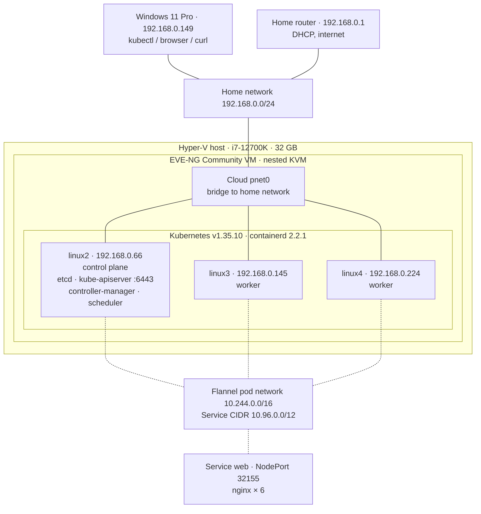

# 3-Node Kubernetes Cluster with kubeadm (EVE-NG Home Lab)
A three-node Kubernetes cluster built with kubeadm on Ubuntu nodes running inside EVE-NG, which itself runs as a nested VM on Hyper-V. The goal was to practice building a cluster the way an integrator does it on real hardware: prepare the nodes, initialize the control plane, add a pod network, join workers, and then break a node on purpose to see what Kubernetes does.

This is a home lab for practice, not a production deployment. Everything below was run and observed in this lab; times come from cluster events.

Environment
Layer	Details
Physical host	Windows 11 Pro, Intel Core i7-12700K, 32 GB RAM, Hyper-V
Lab platform	EVE-NG Community in a Hyper-V VM: 4 vCPU, nested virtualization on, MAC address spoofing on; /dev/kvm present inside EVE-NG
Nodes	3 × Ubuntu Server 22.04.5 LTS, kernel 5.15.0-202-generic, 2 vCPU / 4 GB RAM each
Kubernetes	v1.35.10 (packages from pkgs.k8s.io, branch v1.35)
Container runtime	containerd 2.2.1, SystemdCgroup = true
Pod network	Flannel, pod CIDR 10.244.0.0/16
Services	default service CIDR (10.96.0.0/12)
Node	Role	IP
linux2	control plane	192.168.0.66
linux3	worker	192.168.0.145
linux4	worker	192.168.0.224

Node addresses come from the home router's DHCP. The control plane address is baked into the API server certificates and the join command, so it must not change: reserve it on the router or set it statically with netplan.

## Topology

All three nodes are bridged straight onto the home network through the EVE-NG `pnet0` cloud. Pods talk to each other over the Flannel overlay (`10.244.0.0/16`); the test service is reachable from Windows on any node at port `32155`.
Build steps
1. Prepare every node

scripts/k8s-prep.sh does the full preparation and can be re-run safely. Run it on all three nodes:

bash
sudo bash scripts/k8s-prep.sh

It disables swap, loads overlay and br_netfilter, enables IP forwarding and bridge netfilter, installs containerd with SystemdCgroup = true, adds the pkgs.k8s.io repository and installs kubelet, kubeadm and kubectl (held at the installed version). It also removes two leftovers that broke the first attempt (see Problems and fixes): a kubeadm snap and the installer cdrom entry in sources.list.

Hostnames must be lowercase (linux2, not Linux2), and every node needs a unique hostname, MAC address and product_uuid.

Check before going further:

bash
which kubeadm                  # /usr/bin/kubeadm, not /snap/bin/kubeadm
kubeadm version -o short       # v1.35.x
kubelet --version              # same version
systemctl is-active containerd # active
cat /proc/sys/net/ipv4/ip_forward  # 1
swapon --show                  # empty
2. Initialize the control plane (linux2)
bash
sudo kubeadm init \
  --apiserver-advertise-address=192.168.0.66 \
  --pod-network-cidr=10.244.0.0/16 \
  --node-name=linux2

mkdir -p $HOME/.kube
sudo cp -i /etc/kubernetes/admin.conf $HOME/.kube/config
sudo chown $(id -u):$(id -g) $HOME/.kube/config
3. Install the pod network (Flannel)
bash
kubectl apply -f https://github.com/flannel-io/flannel/releases/latest/download/kube-flannel.yml

Flannel uses 10.244.0.0/16 by default, which matches --pod-network-cidr. Calico's default 192.168.0.0/16 was avoided on purpose because it overlaps the home network.

4. Join the workers (linux3, linux4)
bash
sudo kubeadm join 192.168.0.66:6443 --token <token> \
  --discovery-token-ca-cert-hash sha256:<hash>

The token is valid for 24 hours. A new join command can be printed on the control plane with kubeadm token create --print-join-command.

5. Result
text
NAME     STATUS   ROLES           VERSION    INTERNAL-IP     OS-IMAGE             CONTAINER-RUNTIME
linux2   Ready    control-plane   v1.35.10   192.168.0.66    Ubuntu 22.04.5 LTS   containerd://2.2.1
linux3   Ready    <none>          v1.35.10   192.168.0.145   Ubuntu 22.04.5 LTS   containerd://2.2.1
linux4   Ready    <none>          v1.35.10   192.168.0.224   Ubuntu 22.04.5 LTS   containerd://2.2.1

All system pods (etcd, kube-apiserver, kube-controller-manager, kube-scheduler, coredns × 2, kube-proxy × 3, kube-flannel × 3) were Running. kube-controller-manager and kube-scheduler restarted 4 times during the first minute after init and then stayed up.

Test: worker node failure
Setup
bash
kubectl create deployment web --image=nginx --replicas=3
kubectl expose deployment web --type=NodePort --port=80   # NodePort 32155
kubectl scale deployment web --replicas=6

Six nginx pods were spread across linux3 and linux4. Then linux4 was powered off in EVE-NG.

Timeline (from cluster events)
UTC	Local (UTC−6)	Event
04:23:56	22:23:56	linux4 joins the cluster, NodeReady
04:24:34	22:24:34	Deployment web created, 3 pods
04:25:50	22:25:50	Scaled to 6 pods (3 on linux4)
≈04:26:55	≈22:26:55	linux4 marked not ready and tainted (calculated: eviction time minus 300 s)
04:31:55	22:31:55	TaintManagerEviction of the 3 pods on linux4; 3 replacement pods created on linux3 in the same second
04:39:41	22:39:41	linux4 powered on: kubelet starts, Rebooted event
04:40:45	22:40:45	linux4 NodeNotReady again
04:42:19	22:42:19	Second kubelet start with a new boot ID (Rebooted), node becomes Ready and stays Ready
Results
Detection. The node controller marked linux4 not ready within about a minute of the power-off and set NodeNotReady on its pods.
Rescheduling took 5 minutes after NotReady. Pods get the default toleration of 300 seconds for not-ready / unreachable taints (DefaultTolerationSeconds admission plugin). Only after that did the taint manager evict them and the ReplicaSet create replacements on linux3. From power-off to replacement pods: about 5–6 minutes.
The service stayed available. curl -I http://192.168.0.145:32155 from Windows returned HTTP/1.1 200 OK while linux4 was down, and repeated checks during the outage all returned 200. Pods on a not-ready node are removed from the service endpoints, so traffic went only to the pods on linux3.
No automatic rebalancing. After linux4 came back, all 6 pods stayed on linux3. Kubernetes does not move running pods back to a recovered node; kubectl rollout restart deployment web spreads them again.
Recovery. linux4 registered two kubelet starts with different boot IDs (04:39:41 and 04:42:19). It became stable Ready after the second start.
Problems and fixes
#	Symptom	Cause	Fix
1	VirtualBox not suitable as the EVE-NG host	Hyper-V and VBS were already running on Windows 11; VirtualBox then runs on top of the Windows hypervisor and nested KVM is unreliable	Ran EVE-NG as a Hyper-V VM with Set-VMProcessor -ExposeVirtualizationExtensions $true and MAC spoofing; verified /dev/kvm inside EVE-NG
2	First design used a MikroTik CHR 7.23.8 gateway (10.10.10.0/24, DHCP, NAT); Windows could not ping the nodes behind it	No route on Windows to 10.10.10.0/24, and masquerade rewrote replies to Windows	Added a route on Windows and an srcnat accept exception for the Windows host before masquerade. Later dropped the router: internet access through it was slow (about 300 ms to pkgs.k8s.io versus 15–18 ms directly), so the nodes were connected straight to the home network
3	kubeadm init preflight: [ERROR CRI] ... containerd.sock: no such file, kubelet not found, ip_forward not set to 1	Node preparation had not been completed	Ran the preparation script
4	kubeadm worked but kubelet did not exist; Ubuntu suggested snap install kubelet	kubeadm had been installed as a snap (/snap/bin/kubeadm)	sudo snap remove kubeadm, installed kubelet, kubeadm, kubectl from pkgs.k8s.io and held them. The kubelet snap was not used
5	Preparation script stopped before installing containerd	apt-get update failed: The repository 'file:/cdrom jammy Release' no longer has a Release file	Commented out the cdrom line in /etc/apt/sources.list
6	init failed at wait-control-plane; etcd and kube-apiserver in CrashLoopBackOff	etcd: listen tcp 10.10.10.198:2380: bind: cannot assign requested address. The node had been moved to the home network and no longer had the address used in --apiserver-advertise-address	kubeadm reset -f, removed /etc/cni/net.d, ran init again with the node's real address. Lesson: fix the control plane IP before init
7	After reset, preflight: containerd.sock: connect: connection refused	containerd service was not running	systemctl restart containerd, confirmed active, then init succeeded
Lessons learned
Most failures happened in node preparation, not in Kubernetes itself. A short pre-check (which kubeadm, versions, containerd state, ip_forward, swap) before init saves time.
kubeadm errors that look like API timeouts often have a lower-level cause. Here the real error was in the etcd container log (/var/log/pods/...), not in kubelet or kubeadm output.
The control plane address must be stable before init.
Default failover for pods on a dead worker is about 5 minutes. The service itself keeps working as long as other replicas exist, because endpoints are updated much faster than pods are rescheduled.
A single control plane node is a single point of failure for the API (running workloads keep running).
Next steps
 Reserve the node addresses on the router (or set them with netplan)
 Test control plane failure (power off linux2) and document what keeps working
 Three control plane nodes with stacked etcd and a load balancer for the API
 Ingress controller and persistent storage (CSI)
 Automated node install with PXE and autoinstall / cloud-init
Repository layout
text
.
├── README.md
└── scripts/
    └── k8s-prep.sh   # node preparation, run on every node before init/join

No join tokens, certificate hashes, kubeconfig files or passwords are stored in this repository.
